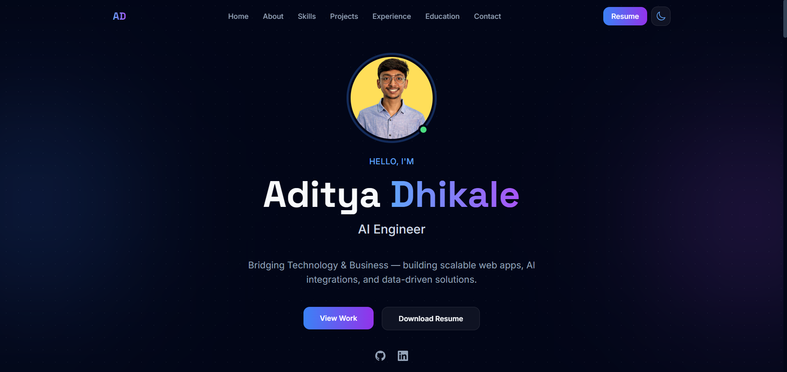

# Aditya Dhikale - Personal Portfolio

A fast, static personal portfolio built with [Astro](https://astro.build) to showcase my work across web development, fintech tools, reporting automation, and operations.

**Live site:** [https://adityadhikale.netlify.app/](https://adityadhikale.netlify.app/)



## Features

- **Static and fast**: Pure Astro with no UI framework. The only JavaScript is a small script for the menu and scroll effects.
- **Responsive**: Layout adapts from phones to wide desktops.
- **Project showcase**: Ten projects with a description, tech-stack tags, and live and code links, all driven from one data file.
- **Accessible**: Skip link, keyboard-visible focus outlines, Escape closes the mobile menu, and `prefers-reduced-motion` is respected.
- **SEO ready**: Canonical URL, Open Graph and Twitter cards, JSON-LD (`WebSite`, `Person`, `BreadcrumbList`), `sitemap.xml`, and `robots.txt`.
- **Resume download**: Direct link to `public/resume.pdf`.

## Tech Stack

- **Astro**: Static site generator (`output: 'static'`)
- **Plain CSS**: Single stylesheet with design tokens in `src/styles/global.css`
- **Vanilla JS**: `public/motion.js` for the header, mobile menu, reveal-on-scroll, and the hero text rotator
- **Google Fonts**: DM Sans, DM Mono, and Playfair Display
- **Netlify**: Hosting and deployment

## Getting Started

### Prerequisites

- Node.js 22.23.4 or later (required by Astro)
- npm 9.6.5 or later

### Install and run

```bash
git clone https://github.com/adityadhikale/portfolio.git
cd portfolio
npm install
npm run dev
```

The dev server runs at `http://localhost:4321`.

### Scripts

| Command | What it does |
| --- | --- |
| `npm run dev` | Start the dev server |
| `npm run build` | Build the static site into `dist/` |
| `npm run preview` | Preview the production build locally |

## Project Structure

```
/public
  AD.svg             # Favicon
  resume.pdf         # Downloadable resume
  motion.js          # Menu, scroll reveal, and hero rotator
  robots.txt
  sitemap.xml
  _redirects
/src
  /assets/images     # Profile picture and social preview image
  /components        # Header.astro, Footer.astro
  /data
    projects.js      # Single source of truth for the project list
  /layouts
    BaseLayout.astro # <head>, SEO tags, JSON-LD, fonts
  /pages
    index.astro      # The single-page site
  /styles
    global.css       # All styles
astro.config.mjs
netlify.toml
```

## Updating Content

**Add or edit a project:** edit `src/data/projects.js`. Each entry takes:

```js
{
  name: 'Project name',
  type: 'Short category label',
  description: 'One or two sentences.',
  stack: ['Next.js', 'Supabase'], // optional
  github: 'https://github.com/...', // optional
  demo: 'https://...',              // optional
}
```

Projects appear in the order listed, so put the most important first. Live and code links show up automatically when present.

**Change text, education, or experience:** edit `src/pages/index.astro`.

**Social preview image:** replace `src/assets/images/portfolio-preview.png`.

## Deployment

The site is deployed on Netlify. `netlify.toml` runs `npm run build` and publishes `dist/`, so pushing to `main` triggers a new deploy.

## Contact

Aditya Dhikale - [adityadhikale2003@gmail.com](mailto:adityadhikale2003@gmail.com)

- GitHub: [github.com/adityadhikale](https://github.com/adityadhikale)
- LinkedIn: [linkedin.com/in/aditya-dhikale-674643288](https://www.linkedin.com/in/aditya-dhikale-674643288/)
